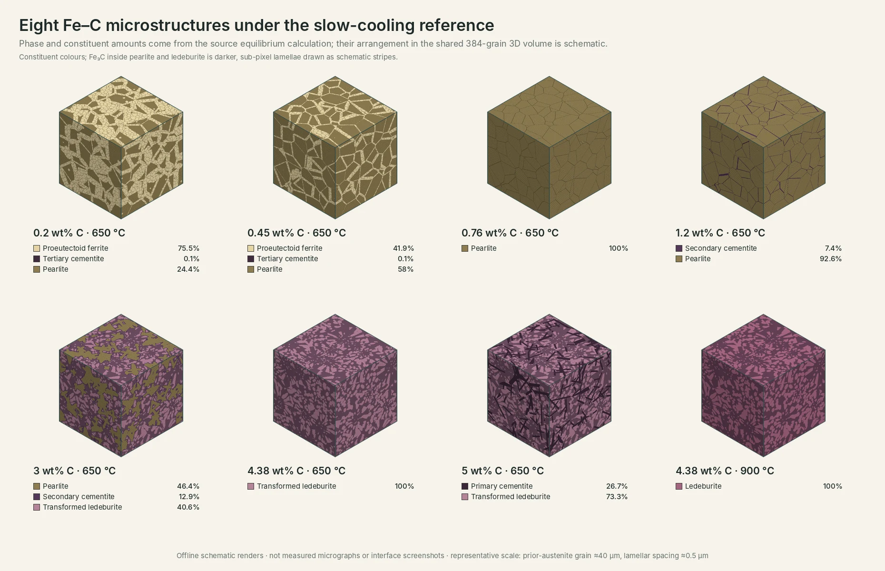
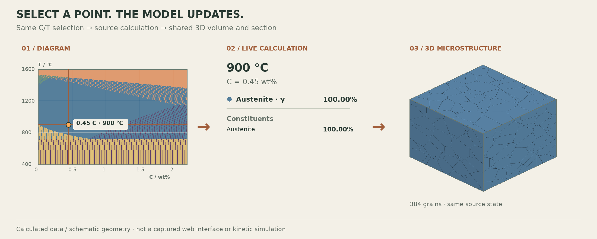
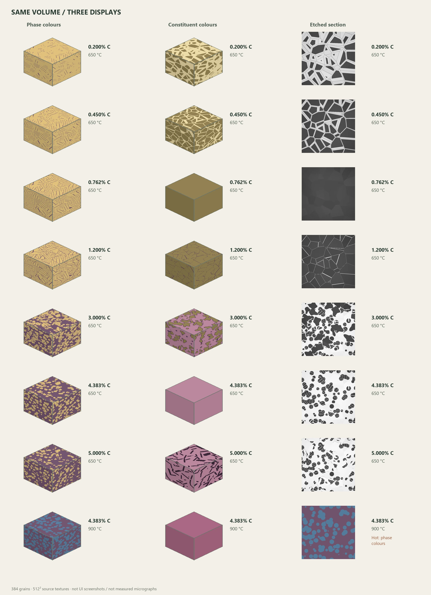
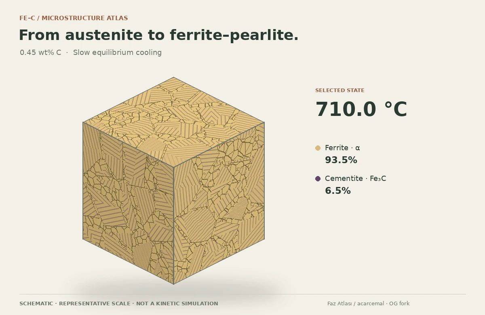
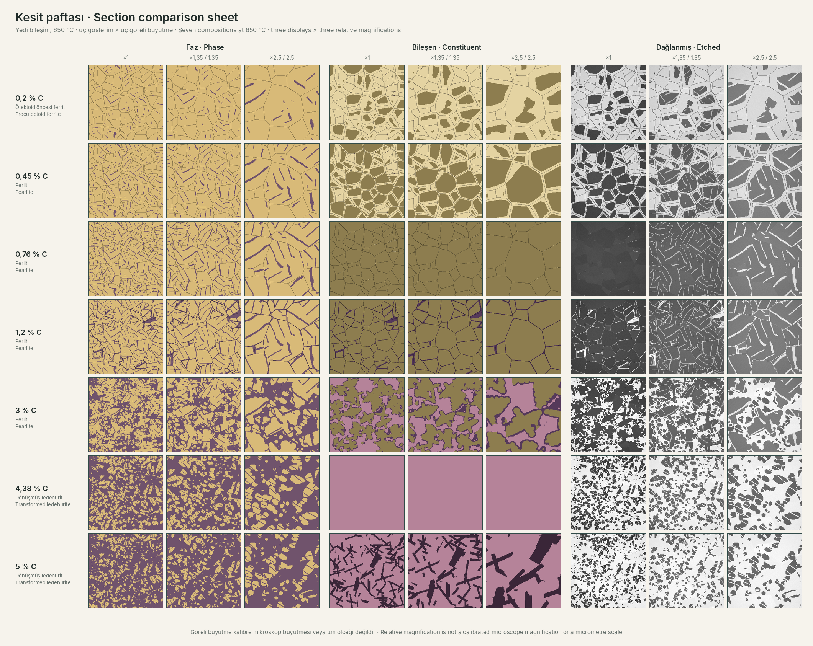

<div align="center">

<sub>OG FORK · INTERACTIVE MATERIALS EDUCATION</sub>

# Faz Atlası

### From the phase diagram to the microstructure.

Explore Fe–C equilibrium, follow the constituent budgets,<br>
and look inside the same structure — from a 3D section to an atomic reference.

[](https://github.com/gulOguzhanSkry/faz-atlasi/tree/v1.2.2)
[](LICENSE)


**[Open the atlas ↗](https://guloguzhanskry.github.io/faz-atlasi/?lang=en)** &nbsp; · &nbsp;
[Türkçe](README.tr.md) &nbsp; · &nbsp;
[Watch the introduction](https://guloguzhanskry.github.io/faz-atlasi/gorseller/mikroyapi-sogume-en.mp4)

[](web/gorseller/readme-microstructures-en.webp)

<sub>384 grains · 512² textures · eight source-calculated states · offline schematic renders, not UI screenshots or measured micrographs</sub>

</div>

---

## The diagram selection updates the microstructure live

**The cube is not a fixed, preselected illustration.** Changing carbon or temperature sends the selected C/T point to the source equilibrium calculation. Phase and constituent amounts are recalculated; the 3D phase/constituent arrangement and the section of that same volume update to represent the new state.

[](https://guloguzhanskry.github.io/faz-atlasi/?lang=en)

**Select a point → calculate phase and constituent amounts → update the cube and section.** This explanatory animation holds C at 0.45 wt% while the selected temperature changes through 900, 780, 740 and 650 °C. Every frame's percentages and 384-grain cube come from the same source-calculated state.

[Open the large 900 vs 650 °C comparison](web/gorseller/secim-mikroyapi-en.webp) · [Try the live application](https://guloguzhanskry.github.io/faz-atlasi/?lang=en)

<sub>This is a schematic explanation of the calculation link, not a captured web interface or a physical transformation-time simulation. Phase fractions are calculated; grain and lamellar geometry is illustrative.</sub>

## What will I see in the application?

Faz Atlası is an interactive web application that takes you from a diagram to **the calculation at your selected point, a 3D microstructure and an atomic reference**. Change carbon or temperature and inspect the phase table, constituent budgets and sections of the same volume together.

**Try it without installation:** [English live application](https://guloguzhanskry.github.io/faz-atlasi/?lang=en) · [Turkish live application](https://guloguzhanskry.github.io/faz-atlasi/?lang=tr)

| What you want to see | Start here |
| :--- | :--- |
| What does the page look like? | [Interface and earlier views](#interface-and-earlier-views) |
| How do the cube and sections relate? | [Three displays of the same volume](#three-displays-of-the-same-volume) |
| Which features are available? | [Explore the features in detail](#explore-the-features-in-detail) |
| How do I use it on a phone? | [A wide workspace on a small screen](#a-wide-workspace-on-a-small-screen) |
| I want to try a worked example | [Suggested exploration routes](#suggested-exploration-routes) |
| Which results are calculated and which are schematic? | [Read the model correctly](#read-the-model-correctly) |

## Interface and earlier views

The views from the first README are restored here. **These are screenshots of the original Faz Atlası interface**, showing the retained diagram, steel library and information cards. The new OG constituent layer, cube and mobile workspace extend this foundation; the earlier phone screenshot does not depict the new pan-and-lock controls.

### Phase diagram: a selected point and its calculation cards

[](gorseller/2-fe-c-diyagrami-en.png)

The carbon–temperature diagram appears on the left, with the selected point and calculations on the right. Select a point to read **phase mass fractions**, **the carbon content of each phase**, **critical temperatures** and **isothermal boundaries** together.

### Steel and alloy view: the 42CrMo4 example

[](gorseller/1-kesit-42CrMo4-en.png)

The steel library, available calculated isopleths and original heat-treatment tools remain available. **The binary Fe–Fe₃C microstructure calculation is not an alloy-isopleth model**; selecting an alloy explicitly disables the new binary cube and constituent layer.

<table>
<tr><th>Built-in explanations</th><th>Earlier phone layout</th></tr>
<tr>
<td width="70%"><a href="gorseller/3-bilgi-penceresi-en.png"></a></td>
<td width="30%" align="center"><a href="gorseller/4-telefon-en.png"></a></td>
</tr>
</table>

Information buttons explain the metallurgical concepts behind the cards. The new mobile version adds a wide pannable workspace and framing lock instead of compressing the diagram.

## One point. Three ways to understand it.

| **01 / Equilibrium** | **02 / Microstructure** | **03 / Atomic reference** |
| :--- | :--- | :--- |
| Select carbon and temperature on the calculated Fe–Fe₃C diagram. Read the phases, their carbon contents and mass fractions. | Separate pearlite, primary/secondary cementite and ledeburite ancestry. Cut the shared 3D volume and compare its appearances. | Inspect FCC austenite, BCC ferrite and cementite reference cells. Explore illustrative interstitial carbon positions. |

**Try a complete path in four steps:** choose **0.45 wt% C**, move below the eutectoid, open **3D microstructure**, then switch the section from **phase colours** to **etched appearance**. At an exact invariant, select the reaction progress **ξ** to resolve the otherwise non-unique phase amounts.

## What this fork adds

- **Inspectable constituent budgets** — source-derived invariant compositions, per-constituent phase breakdowns and lever-rule calculations.
- **A second reading layer on the diagram** — P/S/E/C composition references and selectable slow-cooling constituent regions, distinct from phase boundaries.
- **A reusable 3D inspector** — floating dock, retained camera and selection, section planes, phase/constituent/grain colours, and an atomic reference view.
- **A shared 2D section** — the cube's own label map, relative magnification, illustrative Nital appearance, deterministic optical effects and annotated PNG export.
- **A reproducible introduction** — a short cooling sequence generated from the same source calculation and geometry, in both interface languages.

The original project already includes slow-cooling constituent estimates. This fork extends their explanation, source-state connection and visual exploration; it does not claim to have introduced those concepts.

### A wide workspace on a small screen

The mobile diagram keeps its working area instead of shrinking the plot to an unreadable thumbnail. Switch between **Pan** and **Select point**; drag to pan and pinch to zoom. **Lock view** keeps the framing still while you inspect a point. Zoom buttons, directional controls, **1:1 view** and **Fit diagram** provide explicit alternatives to gestures. Composition and temperature inputs remain outside the transformed diagram. The desktop layout stays unchanged.

<details>
<summary><strong>Explore the visual and technical evidence</strong></summary>

| Review | Contents |
| :--- | :--- |
| [Same volume, three displays](web/gorseller/readme-display-modes-en.webp) | Maximum-detail phase cubes, constituent cubes and etched sections from eight computed states. |
| [Section comparison sheet](web/gorseller/kesit-paftasi.png) | Seven compositions, three appearances and three relative magnifications. |
| [Independent acceptance](docs/INDEPENDENT_ACCEPTANCE.md) | Conservation, invariant progress, geometry, shared-section identities and remaining acceptance limits. |
| [3D inspector](docs/STAGE3_DELIVERY.md) · [Section and animation](docs/STAGE3B4_DELIVERY.md) | Architecture, controls, reproducible assets and explicitly stated scope. |
| [Source-trace comparison](hesap/rapor/og/TRACE_COMPARISON.md) | Why the shipped phase data was retained rather than silently replaced. |
| [Portfolio integration](docs/PORTFOLIO_INTEGRATION.md) | A pinned calculation source shared with the OG portfolio. |

</details>

## Explore the features in detail

### 1. Query the equilibrium diagram

- Set carbon and temperature numerically or select a point on the diagram.
- Use the **Full, Steel, Eutectoid, α-ferrite and Peritectic** view presets.
- Locate α-ferrite, γ-austenite, δ-ferrite, cementite and liquid fields.
- Distinguish the phase mass fraction from the carbon concentration inside that phase.
- Read the tie-line, lever rule and composition boundaries along the selected isotherm.
- Pin comparison points with **Shift+click** in the original interface.

### 2. Separate phases from microconstituents

The new panel goes beyond displaying “α + Fe₃C”. Under its slow-cooling reference, it explains **which constituents contain those phases**:

| Constituent / ancestry | What the panel shows |
| :--- | :--- |
| Proeutectoid ferrite | The ferrite share rejected before pearlite forms. |
| Pearlite | The total α + Fe₃C constituent and its internal phase breakdown. |
| Secondary cementite · Fe₃C(II) | Cementite rejected from austenite, assigned separately or retained within eutectic ancestry. |
| Tertiary cementite · Fe₃C(III) | Rejection associated with decreasing carbon solubility in ferrite. |
| Primary austenite / cementite | Solid ancestry formed before the eutectic reaction. |
| Ledeburite / transformed ledeburite | The γ + Fe₃C eutectic region or its post-transformation inventory. |

Open **Lever-rule calculation and assumptions** to inspect compositions, formulas and scope. P/S/E/C verticals are composition references, not added phase boundaries. Click an italic constituent label to select its region centre.

### 3. Expand the cube and explore the same volume

Open the inspector from **Open detail** in the lower-left dock or **Open 3D microstructure** in the side panel.

| Control | What it does |
| :--- | :--- |
| Phases / Constituents / Grain identities | Changes whether colour identifies an equilibrium phase, a microconstituent or a geometric grain ID. |
| 24 / 96 / **192** / 384 grains | Changes drawing detail; the default is 192 grains. Physical grain size is not calculated. |
| X / Y / Z and section position | Cuts the same volume along different planes. The initial section position is 1.00. |
| Camera buttons | Rotate, zoom in/out and return to the first view. |
| Heat / Cool / Stop | Move along temperature and stop at source phase boundaries. Playback speed is not processing time. |
| Minimise to bottom left | Retains the existing model, camera, cut and detail instead of recreating the cube. |
| Atomic structure | Switches from grain scale to a phase reference cell. |

The expanded layout reserves room for the cube and camera controls; long tool panels scroll independently. Reduced-motion preference disables playback. A shared 2D fallback is available when WebGL cannot be used.

<a id="three-displays-of-the-same-volume"></a>

### 4. Three displays of the same volume

The gallery below contains **offline renders from the application's shared model, not interface screenshots**. Each row compares the same composition and temperature: **phase colours → constituent colours → etched section**.

[](web/gorseller/readme-display-modes-en.webp)

- **Phase colours:** distinguish equilibrium phases such as α, γ and Fe₃C.
- **Constituent colours:** distinguish pearlite, ledeburite and proeutectoid ancestry.
- **Etched appearance:** illustrative Nital contrast, with bright cementite, light ferrite and dark pearlitic regions.
- **Relative magnification:** examines the same section more closely without generating a different structure.
- **Optical effects:** surface noise and grain contrast do not change the identity map.
- **PNG export:** renders a separate 512² section with C, temperature, cooling assumption and schematic/unscaled metadata.

Above the eutectoid, or while residual γ remains, etched mode falls back to phase colours with an explanation. This is not a hot-etching or quenching simulation.

### 5. Inspect atomic references

| Phase | Reference view |
| :--- | :--- |
| γ-austenite | FCC cell and example octahedral carbon interstitials. |
| α-ferrite and δ-ferrite | BCC references with distorted octahedral coordination. |
| Cementite | Pnma, oP16 prototype; 12 Fe + 4 C per cell. |
| Liquid | Nonperiodic positional example, not molecular dynamics. |

Inspect cell repetitions, atom size, carbon, candidate interstitials and neighbour/coordination geometry. Carbon populations are rounded to integers using the phase's own carbon concentration, with the finite-volume representation error disclosed. Reference cell dimensions are not presented as lattice parameters measured at the selected temperature.

### 6. Retained steel and heat-treatment tools

The original **63-grade steel library and 52 calculated alloy isopleths** remain available. Explore grade search, composition ranges, custom compositions, carbide fields, process windows and information cards. Calculated CALPHAD sections and empirical estimates have separate labels. The binary cube is not used to predict alloy-steel microstructure.

## Suggested exploration routes

| Start with | What to investigate |
| :--- | :--- |
| 0.20 wt% C · 650 °C | Why are the ferrite phase percentage and the pearlite constituent percentage different quantities? |
| 0.45 wt% C · 650 °C | The budgets of proeutectoid ferrite, pearlite and separately assigned tertiary cementite. |
| Source eutectoid composition · about 0.762 wt% C | Pearlite below the eutectoid; ξ progress at the exact invariant temperature. |
| 1.20 wt% C · 650 °C | Pearlite versus secondary cementite and illustrative boundary placement. |
| 3 wt% C · 650 °C | Pearlite from primary austenite, secondary cementite and transformed ledeburite. |
| Source eutectic composition · about 4.383 wt% C | Compare γ + Fe₃C at 900 °C with transformed ledeburite at 650 °C. |
| 5 wt% C · 650 °C | Primary cementite and transformed-ledeburite ancestry. |

Revisit the same point using **phase**, **constituent** and **grain-identity** colours, then change the section axis. Changing the point recomputes a selected reference state; it does not perform a new physical specimen experiment.

## Introduction animation

[](https://guloguzhanskry.github.io/faz-atlasi/gorseller/mikroyapi-sogume-en.mp4)

**[Play the English video](https://guloguzhanskry.github.io/faz-atlasi/gorseller/mikroyapi-sogume-en.mp4)** · [Turkish version](https://guloguzhanskry.github.io/faz-atlasi/gorseller/mikroyapi-sogume.mp4)

The 0.45 wt% C example moves from 900 °C to the eutectoid, through ξ steps at the exact invariant, and down to 650 °C. The approximately 12-second video illustrates 56 source-calculated states; it is not a 12-second physical heat-treatment cycle.

## Section comparison sheet

[](web/gorseller/kesit-paftasi.png)

Open the full image to compare low, medium and high relative magnification using sections of the same model. The sheet claims neither a calibrated microscope magnification nor a micrometre scale.

## Read the model correctly

> **Equilibrium fractions are calculated. The spatial arrangement is schematic.**

The binary reference is **metastable Fe–Fe₃C**, 400–1600 °C, approximately 1 bar. Constituent ancestry assumes slow cooling from liquid, even when a point is reached by moving upward in temperature. Pearlite and ledeburite are microconstituents, not extra thermodynamic phases.

The model does not predict cooling kinetics, physical grain size, lamellar spacing, graphite, bainite or martensite. A section's area fraction is not forced to equal bulk mass or volume fraction; atom cells are reference illustrations. Alloy isopleths remain available in the original atlas, while the new binary microstructure layer is disabled for alloy states. Numerical conservation is not independent experimental validation. [Scope and methods →](docs/OG_ADDITIONS.md)

## Run it locally

Download or clone the repository, then serve its self-contained `web/` folder:

```sh
python -m http.server 8731 --directory web
```

Open **[localhost:8731](http://localhost:8731/?lang=en)**. No runtime build, CDN or account is required. Once the files are local, the app works without an internet connection. A local HTTP server is needed for the lazy-loaded 3D ES modules; opening an HTML file directly is not the full-featured path.

For development and automated checks only:

```sh
npm ci --ignore-scripts
npm test
```

Optional numerical research tools are documented in [hesap/og](hesap/og/README.md). Their outputs stay separate from the deployed dataset.

## Built on an openly credited foundation

**Original Faz Atlası:** [acarcemal](https://github.com/acarcemal/faz-atlasi) — the calculated diagram, steel library, alloy isopleths and original interface. **Fork additions:** Oğuzhan Gül / OG — constituent-state integration, diagram layer, shared 3D/2D inspector and research/integration tooling. The [original documentation](https://github.com/acarcemal/faz-atlasi/tree/e9b2fce0b604502b94e620104fa6533e1e78bd82) contains the upstream feature and calculation details.

- **CALPHAD:** pycalphad, R. Otis and Z.-K. Liu; binary assessment by Fei & Brosh (2014), `cfe_broshe.tdb`.
- **Alloy data:** MatCalc `mc_fe v2.062`, E. Povoden-Karadeniz and A. Jacob, TU Wien. Derived isopleth data carries the [ODbL 1.0 notice](NOTICE).
- **Metallurgical interpretation:** [Bhadeshia, steel microstructures](https://www.phase-trans.msm.cam.ac.uk/2008/Steel_Microstructure/SM.html) and [Yescas-Gonzalez & Bhadeshia, cast irons](https://www.phase-trans.msm.cam.ac.uk/2001/adi/cast.iron.html).

Code is **[MIT licensed](LICENSE)**; data terms remain distinct. Original author and third-party notices are preserved. See [NOTICE](NOTICE), the vendored Three.js licence and [the atomic-source notes](docs/STAGE3_DELIVERY.md) for attribution.

<div align="center"><sub>Built to make the calculation visible — and its limits readable.</sub></div>
