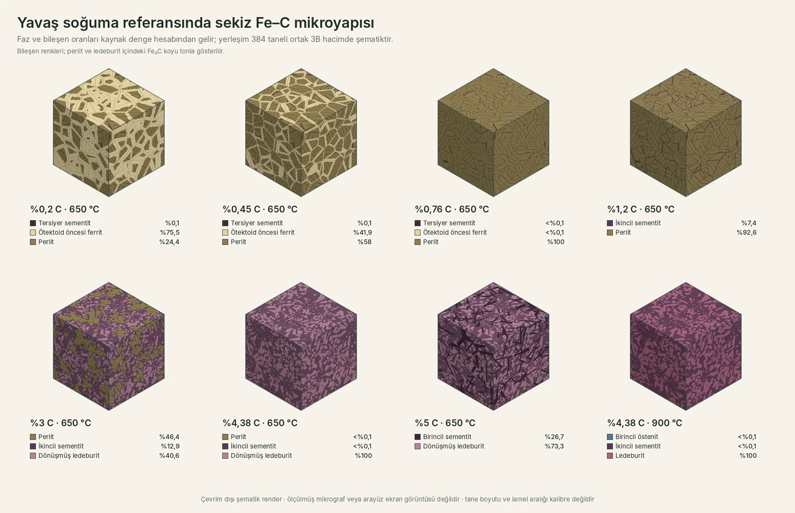
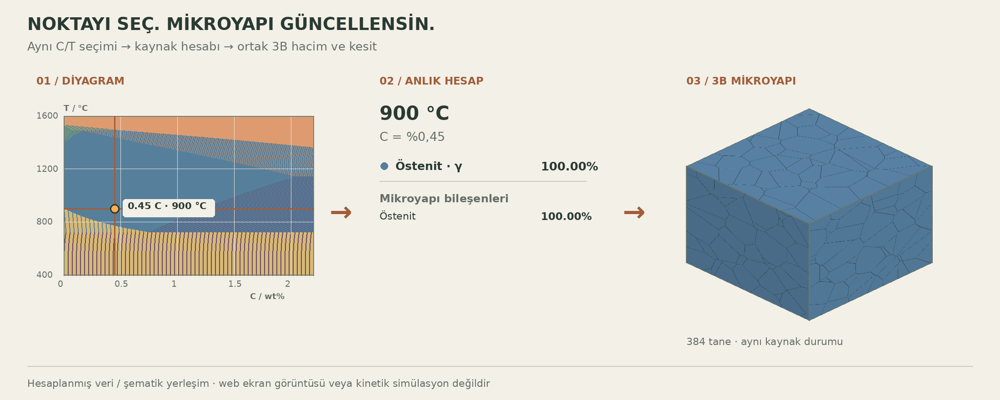
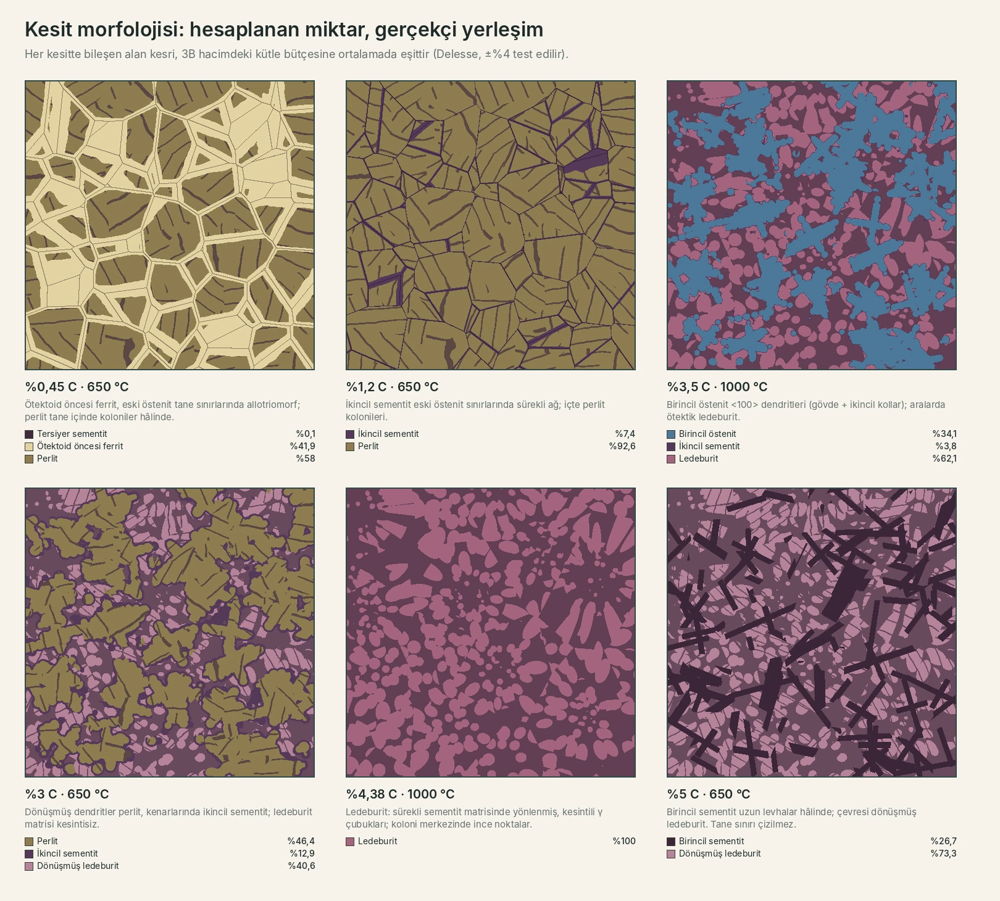
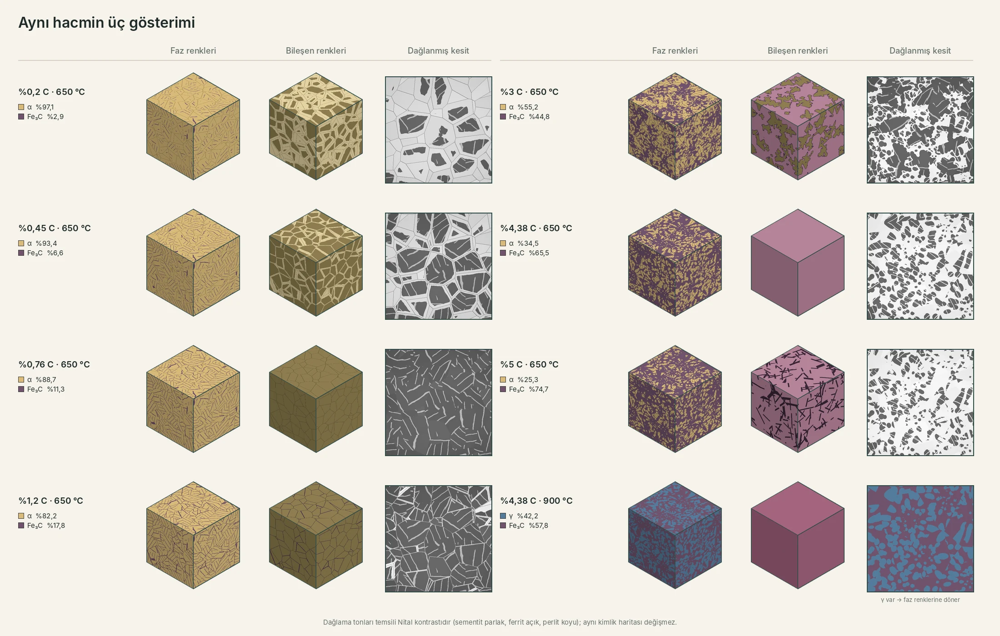
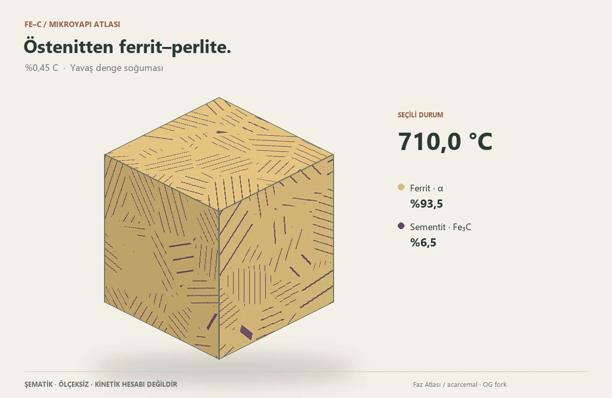
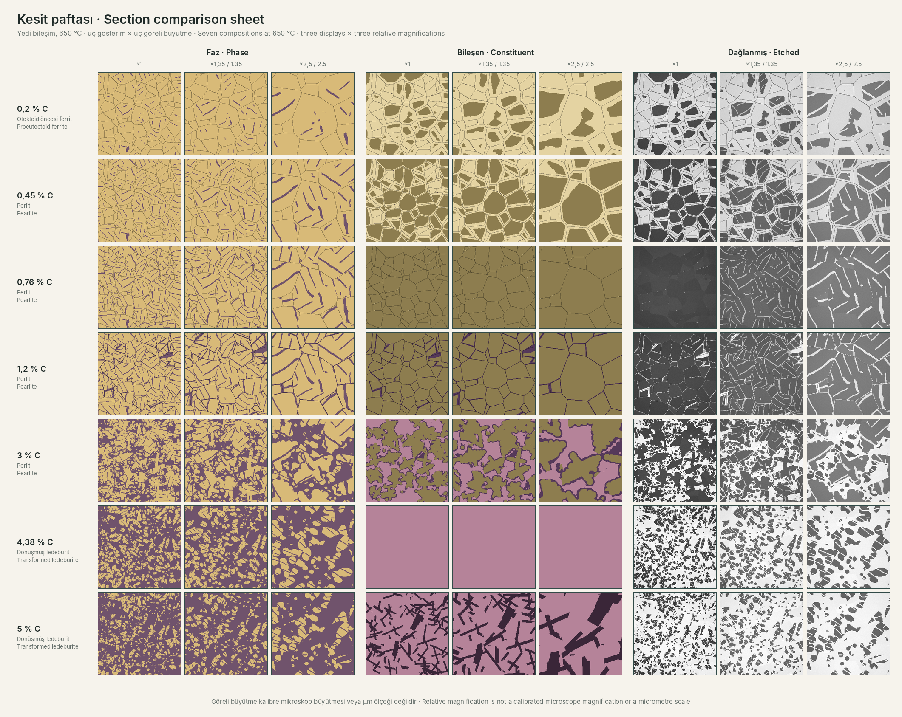

<div align="center">

<sub>OG FORK’U · ETKİLEŞİMLİ MALZEME EĞİTİMİ</sub>

# Faz Atlası

### Faz diyagramından mikroyapının içine.

Fe–C dengesini incele, bileşen hesabının izini sür.<br>
Aynı yapıyı 3B kesitten atomik referans hücresine kadar keşfet.

[](https://github.com/gulOguzhanSkry/faz-atlasi/tree/v1.2.2)
[](LICENSE)


**[Atlası aç ↗](https://guloguzhanskry.github.io/faz-atlasi/?lang=tr)** &nbsp; · &nbsp;
[English](README.md) &nbsp; · &nbsp;
[Tanıtımı izle](https://guloguzhanskry.github.io/faz-atlasi/gorseller/mikroyapi-sogume.mp4)

[](web/gorseller/readme-microstructures.webp)

<sub>384 tane · bileşen renkleri, perlit ve ledeburit içindeki Fe₃C koyu tonla · ortak modelden çevrimdışı şematik render; arayüz ekran görüntüsü veya ölçülmüş mikrograf değildir</sub>

</div>

---

## Diyagramdaki seçim, mikroyapıyı anlık günceller

**Küp, önceden seçilmiş sabit bir görsel değildir.** Diyagramda karbon veya sıcaklık değiştiğinde, seçilen C/T noktası kaynak denge hesabına gider. Faz ve bileşen miktarları yeniden hesaplanır; 3B küpün faz/bileşen yerleşimi ve aynı hacimden alınan kesit bu duruma göre güncellenir.

[](https://guloguzhanskry.github.io/faz-atlasi/?lang=tr)

**Nokta seç → faz ve bileşen paylarını hesapla → küpü ve kesiti güncelle.** Yukarıdaki açıklama animasyonunda C=%0,45 sabittir; seçili sıcaklık 900, 780, 740 ve 650 °C arasında değişir. Her karedeki yüzdeler ve 384 taneli küp aynı kaynak hesap durumundan üretilmiştir.

[900 ve 650 °C karşılaştırmasını büyük aç](web/gorseller/secim-mikroyapi.webp) · [Canlı uygulamada kendin dene](https://guloguzhanskry.github.io/faz-atlasi/?lang=tr)

<sub>Bu görsel hesap bağlantısını anlatan şematik bir çizimdir; web arayüzünün ekran görüntüsü veya fiziksel dönüşüm süresi simülasyonu değildir. Faz payları hesaplanır; tanelerin ve lamellerin geometrisi şematiktir.</sub>

## Gerçekçi kesit morfolojisi

Miktarlar hesaplanır; **yerleşim artık genel lekeler yerine metalurjik morfolojiyi izler**. Her bileşen, oluşum biçimine uyan bir skor alanıyla yerleştirilir ve kaynak kütle bütçesi 3B hacimde yine tam olarak korunur.

[](web/gorseller/readme-morphology.webp)

| Yapı | Nasıl yerleştirilir |
| :--- | :--- |
| Ötektoid öncesi ferrit · Fe₃C(II) | Eski östenit tane sınırlarından büyür (allotriomorf / sürekli ağ); gürültüyle modüle edilmiş sınır uzaklığı kullanılır. |
| Perlit | Tane başına 2–5 koloni; her koloninin kendi bükülmüş lamel yönü vardır. |
| Birincil östenit | <100> dendritleri: gövde ve ikincil kollar kapsüllerin yumuşak birleşimidir; dönüşünce kenarlarında Fe₃C(II) oluşur. |
| Ledeburit | Radyal ötektik koloniler: **sürekli sementit matrisinde** yönlenmiş, kesintili ve dışa doğru kabalaşan γ çubukları; ötektoid altında içlerinde ince lameller. |
| Birincil sementit | Komşu tanelere uzanan uzun, sonlu levhalar. |
| Tane sınırları | Yalnız bileşende gerçekten görünen yerde çizilir; ledeburit, birincil levhalar, sıvı ve dendritik dökümlerde çizilmez. |

Bu seçimler 3B hacmin 2B kesitlerinde stereoloji testleriyle denetlenir: kesit alan kesirleri ortalamada çizim kütle bütçesine eşittir (Delesse, ±%4), ledeburitteki sementit matrisinin ≥%90'ı tek bağlı bölgedir, γ çubukları ve sementit levhaları uzundur, dendrit kesitleri dışbükey değildir, ferrit / Fe₃C(II) eski sınırlar üzerindedir. Yerleşim yine şematiktir: kinetik, tane boyutu veya lamel aralığı tahmin edilmez.

## Uygulamada ne göreceğim?

Faz Atlası, bir diyagram görselini incelemekten başlayıp **seçtiğin noktanın hesabına, 3B mikroyapıya ve atomik referansa** ilerleyebileceğin etkileşimli bir web uygulamasıdır. Karbon oranını veya sıcaklığı değiştir; faz tablosunu, bileşen hesabını ve aynı hacmin kesitlerini birlikte incele.

**Kurulum yapmadan dene:** [Türkçe canlı uygulama](https://guloguzhanskry.github.io/faz-atlasi/?lang=tr) · [İngilizce canlı uygulama](https://guloguzhanskry.github.io/faz-atlasi/?lang=en)

| Görmek istediğin | Buradan başla |
| :--- | :--- |
| Sayfa nasıl görünüyor? | [Arayüz ve önceki görünümler](#arayüz-ve-önceki-görünümler) |
| Küpün ve kesitlerin farkı ne? | [Aynı hacmin üç görünümü](#aynı-hacmin-üç-görünümü) |
| Hangi özellikler var? | [Özellikleri ayrıntılı keşfet](#özellikleri-ayrıntılı-keşfet) |
| Telefonda nasıl kullanılır? | [Küçük ekranda geniş çalışma alanı](#küçük-ekranda-geniş-çalışma-alanı) |
| Bir örneği kendim denemek istiyorum | [Örnek inceleme rotaları](#örnek-inceleme-rotaları) |
| Neresi hesap, neresi şema? | [Modeli doğru okumak](#modeli-doğru-okumak) |

## Arayüz ve önceki görünümler

İlk README’deki görünümler burada yeniden yer alıyor. **Bunlar özgün Faz Atlası arayüzünün ekran görüntüleridir**; korunan diyagram, çelik kütüphanesi ve açıklama kartlarını gösterir. Yeni OG bileşen katmanı, küp ve mobil çalışma alanı bunların üzerine eklenmiştir; eski telefon görseli yeni gezinme/kilitleme arayüzünü temsil etmez.

### Faz diyagramı: seçilen nokta ve hesap kartları

[](gorseller/2-fe-c-diyagrami.png)

Solda karbon–sıcaklık diyagramı, sağda seçilen noktanın fazları ve hesapları bulunur. Bir noktayı seçerek **faz payı**, **fazın kendi karbonu**, **kritik sıcaklıklar** ve **izoterm sınırlarını** birlikte okuyabilirsin.

### Çelik ve alaşım görünümü: 42CrMo4 örneği

[](gorseller/1-kesit-42CrMo4.png)

Çelik kütüphanesi, mevcut hesaplanmış izopletler ve özgün ısıl işlem araçları korunur. **İkili Fe–Fe₃C mikroyapı hesabı ile alaşımlı kesit aynı model değildir**; yeni küp ve bileşen katmanı alaşım seçildiğinde bunu açıkça belirtir ve kapanır.

<table>
<tr><th>Açıklama pencereleri</th><th>Önceki telefon yerleşimi</th></tr>
<tr>
<td width="70%"><a href="gorseller/3-bilgi-penceresi.png"></a></td>
<td width="30%" align="center"><a href="gorseller/4-telefon.png"></a></td>
</tr>
</table>

Kartlardaki bilgi düğmeleri kavramların ne anlama geldiğini açıklar. Yeni mobil sürümde, diyagramı daraltmak yerine geniş çalışma alanında gezinme ve görünümü kilitleme kontrolleri bulunur.

## Bir nokta. Üç inceleme ölçeği.

| **01 / Denge** | **02 / Mikroyapı** | **03 / Atomik referans** |
| :--- | :--- | :--- |
| Hesaplanmış Fe–Fe₃C diyagramında karbon ve sıcaklık seç. Fazları, her fazın karbonunu ve kütle paylarını oku. | Perlit, birincil/ikincil sementit ve ledeburit kökenlerini ayır. Ortak 3B hacmi kesip farklı görünümlerini karşılaştır. | YMK östenit, HMK ferrit ve sementit referans hücrelerini incele. Karbonun örnek arayer konumlarını keşfet. |

**Dört adımda dene:** karbonu **%0,45** seç, ötektoid sıcaklığının altına in, **3B mikroyapıyı aç**, ardından kesitte **faz renkleri** ile **dağlanmış görünümü** karşılaştır. Tam değişmez sıcaklıkta tekil olmayan faz miktarlarını belirlemek için **ξ dönüşüm ilerlemesini** seç.

## Bu fork’ta neler eklendi?

- **İzlenebilir bileşen hesabı** — kaynak verinin değişmez bileşimleri, her bileşenin iç faz dökümü ve kaldıraç kuralı hesabı.
- **Diyagramda ikinci bir okuma katmanı** — faz sınırlarından ayrı çizilen P/S/E/C bileşim referansları ve seçilebilir yavaş soğuma bileşen bölgeleri.
- **Yeniden kullanılabilir 3B inceleyici** — yüzen giriş, korunan kamera ve seçim, kesit düzlemleri, faz/bileşen/tane renkleri ve atomik referans görünümü.
- **Morfolojiye duyarlı yerleşim** — allotriomorf ferrit, perlit kolonileri, Fe₃C(II) ağları, <100> dendritler, sürekli sementit matrisinde ledeburit çubukları ve birincil sementit levhaları; hepsi kaynak bütçesinin tam içinde.
- **Ortak 2B kesit** — küpün kendi kimlik haritası, göreli büyütme, temsili Nital görünümü, deterministik optik etkiler ve bilgi şeritli PNG çıktısı.
- **Yeniden üretilebilir tanıtım** — aynı kaynak hesap ve geometriden üretilmiş, iki dilde kısa bir soğuma akışı.

Özgün proje zaten yavaş soğuma bileşen tahminleri içeriyor. Bu fork onların açıklamasını, seçili denge durumuyla bağlantısını ve görsel incelemesini geliştiriyor; bu kavramları ilk kez getirdiğini iddia etmiyor.

### Küçük ekranda geniş çalışma alanı

Mobilde diyagram, okunmayacak kadar küçültülmek yerine geniş çalışma alanını korur. **Gezin** ve **Nokta seç** modları arasında geçiş yap; sürükleyerek gezin, iki parmakla yakınlaştır. **Görünümü kilitle** ile bir noktayı incelerken kadrajı sabitle. Yakınlaştırma düğmeleri, yön kontrolleri, **1:1 görünüm** ve **Diyagramı sığdır**, hareketlere açık alternatifler sunar. Karbon ve sıcaklık girişleri dönüştürülen diyagramın dışında kalır. Masaüstü yerleşimi korunur.

<details>
<summary><strong>Görsel ve teknik kanıtları incele</strong></summary>

| İnceleme | İçerik |
| :--- | :--- |
| [Aynı hacim, üç görünüm](web/gorseller/readme-display-modes.webp) | En yüksek ayrıntıda sekiz hesap durumunun faz küpleri, bileşen küpleri ve dağlanmış kesitleri. |
| [Kesit morfolojisi](web/gorseller/readme-morphology.webp) | Her bileşenin nasıl yerleştirildiğini gösteren altı hesap durumu. |
| [Kesit karşılaştırma paftası](web/gorseller/kesit-paftasi.png) | Yedi bileşim, üç görünüm ve üç göreli büyütme. |
| [Bağımsız kabul kontrolleri](docs/INDEPENDENT_ACCEPTANCE.md) | Korunum, değişmez ilerlemesi, geometri, ortak kesit kimlikleri ve kalan kabul sınırları. |
| [3B inceleyici](docs/STAGE3_DELIVERY.md) · [Kesit ve animasyon](docs/STAGE3B4_DELIVERY.md) | Mimari, kontroller, yeniden üretilebilir varlıklar ve açık kapsam. |
| [Kaynak iz karşılaştırması](hesap/rapor/og/TRACE_COMPARISON.md) | Yayındaki faz verisinin neden sessizce değiştirilmediği. |
| [Portfolyo bağlantısı](docs/PORTFOLIO_INTEGRATION.md) | OG portfolyosuyla paylaşılan, sürümü sabitlenmiş hesap kaynağı. |

</details>

## Özellikleri ayrıntılı keşfet

### 1. Denge diyagramını sorgula

- Karbon ve sıcaklığı sayısal girişlerle ya da diyagramdan seç.
- **Tamamı, Çelik, Ötektoid, α-ferrit ve Peritektik** ön ayarlarıyla ilgili alanı incele.
- α-ferrit, γ-östenit, δ-ferrit, sementit ve sıvının bulunduğu bölgeleri gör.
- Fazların kütle payını ve her fazın kendi karbon derişimini ayırt et.
- Bağlantı çizgisini, kaldıraç kuralını ve seçili izotermdeki bileşim sınırlarını oku.
- Noktaları sabitle; özgün arayüzde **Shift+tık** ile karşılaştırma noktası ekle.

### 2. Faz ile mikroyapı bileşenini ayır

Yeni panel yalnızca “α + Fe₃C” yazmakla kalmaz. Yavaş soğuma referansı altında bu fazların **hangi bileşenlerin içinde bulunduğunu** da açıklar:

| Bileşen / köken | Panelde ne görürsün? |
| :--- | :--- |
| Ötektoid öncesi ferrit | Perlit oluşmadan önce ayrılan ferritin payı. |
| Perlit | α + Fe₃C içeren bileşenin toplamı ve kendi iç faz dökümü. |
| İkincil sementit · Fe₃C(II) | Östenitten ayrılan sementit; kökene göre ayrı ya da ötektik bölgenin içinde tutulur. |
| Tersiyer sementit · Fe₃C(III) | Ferritin azalan karbon çözünürlüğüyle ilişkili ayrılma payı. |
| Birincil östenit / sementit | Ötektik dönüşümden önce oluşmuş katı kökeni. |
| Ledeburit / dönüşmüş ledeburit | Ötektik bölgenin γ + Fe₃C veya dönüşüm sonrası bileşen dökümü. |

**Kaldıraç kuralı hesabı ve varsayımlar** bölümünü açarak kullanılan bileşimleri, formülleri ve kapsamı gör. P/S/E/C dikeyleri bileşim referansıdır; yeni faz sınırı değildir. İtalik bileşen etiketine tıklamak ilgili bölgenin ortasını seçer.

### 3. Küpü büyüt, aynı hacmin içinde ilerle

Sol alttaki **Detayı aç** girişinden ya da sağ paneldeki **3B mikroyapıyı aç** düğmesinden inceleyiciyi aç.

| Kontrol | Ne yapar? |
| :--- | :--- |
| Fazlar / Bileşenler / Tane kimlikleri | Rengin fazı mı, mikroyapı bileşenini mi, geometrik tane kimliğini mi belirttiğini değiştirir. |
| 24 / 96 / **192** / 384 tane | Çizim ayrıntısını değiştirir; varsayılan 192 tanedir. Fiziksel tane boyutu hesaplanmaz. |
| X / Y / Z ve kesit konumu | Aynı hacmi farklı düzlemlerde keser. Başlangıç konumu 1,00'dır. |
| Kamera düğmeleri | Döndürme, yaklaşma, uzaklaşma ve ilk görünüme dönüş sağlar. |
| Isıt / Soğut / Durdur | Sıcaklık boyunca ilerler; kaynak faz sınırlarında durur. Hız gerçek işlem süresi değildir. |
| Sol alta küçült | Küpü kapatıp yeniden oluşturmaz; mevcut model, kamera, kesit ve seçili ayrıntı korunur. |
| Atomik yapı | Tane ölçeğinden seçilen fazın kristal referansına geçer. |

Büyük görünümde küp ve kamera düğmeleri için yer ayrılır; uzun araç panelleri kendi içinde kayar. Hareket azaltma tercihinde oynatma kapalıdır. WebGL kullanılamadığında ortak 2B kesit yedeği bulunur.

<a id="aynı-hacmin-üç-görünümü"></a>

### 4. Aynı hacmin üç görünümü

Aşağıdaki galeri **gerçek arayüz ekranı değil**, uygulamanın ortak modelinden alınmış çevrimdışı renderlardır. Her satır aynı bileşimi ve sıcaklığı karşılaştırır: **faz renkleri → bileşen renkleri → dağlanmış kesit**.

[](web/gorseller/readme-display-modes.webp)

- **Faz renkleri:** α, γ ve Fe₃C gibi denge fazlarını ayırır.
- **Bileşen renkleri:** perlit, ledeburit ve ötektoid öncesi kökenleri ayırır.
- **Tane sınırları:** çeliklerde çizilir; gerçek dağlamada eski östenit ağı görünmeyen ledeburit, birincil sementit ve dendritik dökümlerde gizlenir.
- **Dağlanmış görünüm:** temsili Nital kontrastı; sementit parlak, ferrit açık, perlitik bölgeler koyudur.
- **Göreli büyütme:** yeni bir mikroyapı üretmez; aynı kesitte farklı yakınlıkta inceleme sağlar.
- **Optik etkiler:** yüzey gürültüsü ve tane kontrastı kimlik haritasını değiştirmez.
- **PNG dışa aktarma:** ayrı 512² kesite C, sıcaklık, soğuma varsayımı ve şematik/ölçeksiz bilgisi ekler.

Ötektoid üstünde veya kalan γ bulunduğunda dağlanmış mod, açıklamayla faz renklerine döner. Bu bir sıcak dağlama veya su verme simülasyonu değildir.

### 5. Atomik referansları incele

| Faz | Referans gösterimi |
| :--- | :--- |
| γ-östenit | YMK / FCC hücre ve karbon için oktahedral arayer örnekleri. |
| α-ferrit ve δ-ferrit | HMK / BCC referansları; çarpık oktahedral komşuluk. |
| Sementit | Pnma, oP16 prototipi; bir hücrede 12 Fe + 4 C. |
| Sıvı | Periyodik olmayan konum örneği; moleküler dinamik değildir. |

Hücre tekrarını, atom boyutunu, karbonu, aday arayerleri ve komşuluk/koordinasyon çizimini inceleyebilirsin. Karbon sayısı fazın kendi karbon derişimine göre tam sayıya yuvarlanır; sınırlı hacmin temsil hatası gösterilir. Referans hücrelerin boyutları, seçili sıcaklıkta ölçülmüş bir örgü parametresi olarak sunulmaz.

### 6. Korunan çelik ve ısıl işlem araçları

Özgün projeden **63 çeliklik kütüphane ve 52 hesaplanmış alaşımlı kesit** korunur. Kalite arama, bileşim aralıkları, kullanıcı bileşimi, karbür bölgeleri, işlem pencereleri ve açıklama kartları incelenebilir. Hesaplanmış CALPHAD kesiti ile ampirik bağıntıların etiketleri ayrıdır. Alaşımlı çelik için ikili küp üzerinden yapı tahmini yapılmaz.

## Örnek inceleme rotaları

| Başlangıç | Ne inceleyebilirsin? |
| :--- | :--- |
| %0,20 C · 650 °C | Ferrit ağırlıklı durumda faz yüzdesi ile perlit bileşeninin yüzdesi neden aynı değildir? |
| %0,45 C · 650 °C | Ötektoid öncesi ferrit, perlit ve ayrı gösterilen tersiyer sementit bütçeleri. |
| Kaynak ötektoid bileşim · yaklaşık %0,762 C | Ötektoid altında perlit; tam değişmez sıcaklıkta ξ ile dönüşüm ilerlemesi. |
| %1,20 C · 650 °C | Perlit ile ikincil sementitin ayrımı ve sınır yerleşimi. |
| %3 C · 650 °C | Birincil östenit kökenli perlit, ikincil sementit ve dönüşmüş ledeburit. |
| Kaynak ötektik bileşim · yaklaşık %4,383 C | 900 °C'deki γ + Fe₃C ile 650 °C'deki dönüşmüş ledeburitin karşılaştırılması. |
| %5 C · 650 °C | Birincil sementit ve dönüşmüş ledeburit kökenleri. |

Aynı noktayı **faz**, **bileşen** ve **tane kimliği** renklerinde yeniden incele; ardından kesit yönünü değiştir. Noktayı değiştirmek yeni bir fiziksel numune deneyi yapmaz; seçili referans durumu yeniden hesaplar.

## Tanıtım animasyonu

[](https://guloguzhanskry.github.io/faz-atlasi/gorseller/mikroyapi-sogume.mp4)

**[Türkçe videoyu aç](https://guloguzhanskry.github.io/faz-atlasi/gorseller/mikroyapi-sogume.mp4)** · [İngilizce sürüm](https://guloguzhanskry.github.io/faz-atlasi/gorseller/mikroyapi-sogume-en.mp4)

%0,45 C örneği, 900 °C'den ötektoide; tam değişmezde ξ adımlarına ve 650 °C'ye ilerler. Yaklaşık 12 saniyelik video, 56 kaynak hesap durumunun görsel anlatımıdır; 12 saniyelik gerçek bir ısıl çevrim değildir.

## Kesit karşılaştırma paftası

[](web/gorseller/kesit-paftasi.png)

Büyük görüntüyü açarak düşük, orta ve yüksek göreli büyütmede aynı modelin kesitlerini karşılaştırabilirsin. Bu paftada fiziksel mikroskop büyütmesi veya mikrometre ölçeği iddia edilmez.

## Modeli doğru okumak

> **Denge payları hesaplanır. Uzaydaki yerleşim şematiktir.**

İkili referans **metastabil Fe–Fe₃C**, 400–1600 °C ve yaklaşık 1 bar koşullarındadır. Bileşen kökeni, noktaya sıcaklığı artırarak gelinse bile sıvıdan yavaş soğuma geçmişini varsayar. Perlit ve ledeburit ayrı termodinamik fazlar değil, mikroyapı bileşenleridir.

Soğuma kinetiği, fiziksel tane boyutu, lamel aralığı, grafit, beynit ve martenzit tahmin edilmez. Tek bir kesitin alan payı çizim bütçesi etrafında değişir (ortalamada eşittir); çizim bütçesi yoğunlukla düzeltilmiş hacim payı değil, kütle payıdır; atom hücreleri referans çizimleridir. Özgün atlasın alaşımlı kesitleri korunur; yeni ikili mikroyapı katmanı alaşımlı durumlarda kapalıdır. Sayısal korunum, bağımsız deneysel doğrulama değildir. [Kapsam ve yöntem →](docs/OG_ADDITIONS.md)

## Bilgisayarında çalıştır

Depoyu indir veya klonla; ardından kendi dosyalarını içeren `web/` klasörünü sun:

```sh
python -m http.server 8731 --directory web
```

**[localhost:8731](http://localhost:8731/?lang=tr)** adresini aç. Çalışma sırasında derleme, CDN veya hesap gerekmez. Dosyalar bilgisayarındayken internet bağlantısı olmadan kullanılabilir. Sonradan yüklenen 3B ES modülleri için yerel HTTP sunucusu gerekir; HTML dosyasına çift tıklamak tüm özellikleri açan yöntem değildir.

Yalnız geliştirme ve otomatik kontroller için:

```sh
npm ci --ignore-scripts
npm test
```

İsteğe bağlı sayısal araştırma araçları [hesap/og](hesap/og/README.md) içinde anlatılır. Çıktıları, yayında kullanılan veri setinden ayrı tutulur.

## Kaynağı açıkça belirtilen bir temel

**Özgün Faz Atlası:** [acarcemal](https://github.com/acarcemal/faz-atlasi) — hesaplanmış diyagram, çelik kütüphanesi, alaşımlı kesitler ve özgün arayüz. **Fork eklemeleri:** Oğuzhan Gül / OG — bileşen–durum bağlantısı, diyagram katmanı, ortak 3B/2B inceleyici ve araştırma/entegrasyon araçları. Ayrıntılı özgün özellikler ve hesap yöntemleri [kaynak projenin belgelerinde](https://github.com/acarcemal/faz-atlasi/tree/e9b2fce0b604502b94e620104fa6533e1e78bd82) bulunur.

- **CALPHAD:** pycalphad, R. Otis ve Z.-K. Liu; ikili değerlendirme Fei & Brosh (2014), `cfe_broshe.tdb`.
- **Alaşım verisi:** MatCalc `mc_fe v2.062`, E. Povoden-Karadeniz ve A. Jacob, TU Wien. Türetilmiş izoplet verilerinin [ODbL 1.0 bildirimi](NOTICE) korunur.
- **Metalurjik yorum:** [Bhadeshia, çelik mikroyapıları](https://www.phase-trans.msm.cam.ac.uk/2008/Steel_Microstructure/SM.html) ve [Yescas-Gonzalez & Bhadeshia, dökme demirler](https://www.phase-trans.msm.cam.ac.uk/2001/adi/cast.iron.html).

Kod **[MIT lisanslıdır](LICENSE)**; veri koşulları ayrıdır. Özgün yazar ve üçüncü taraf bildirimleri korunmuştur. Atıflar için [NOTICE](NOTICE), dağıtılan Three.js lisansı ve [atomik kaynak notları](docs/STAGE3_DELIVERY.md) incelenebilir.

<div align="center"><sub>Hesabı görünür, sınırlarını okunur kılmak için.</sub></div>
